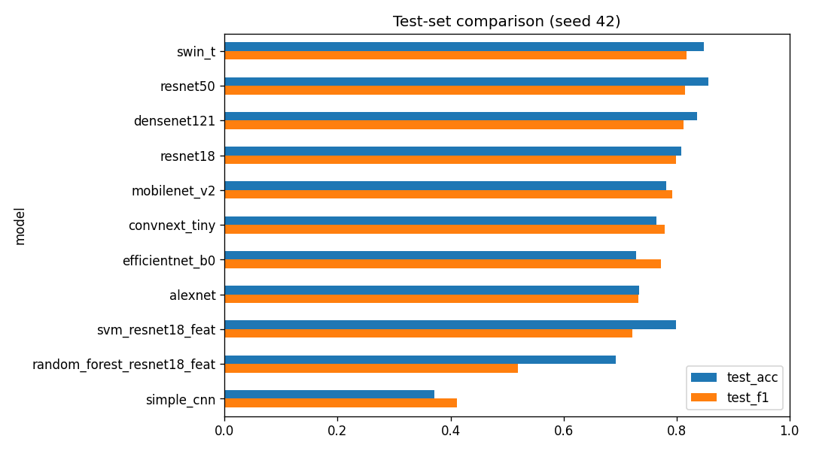
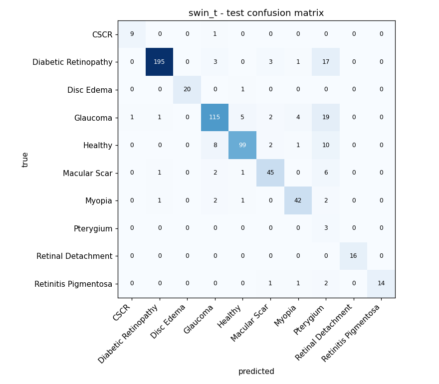
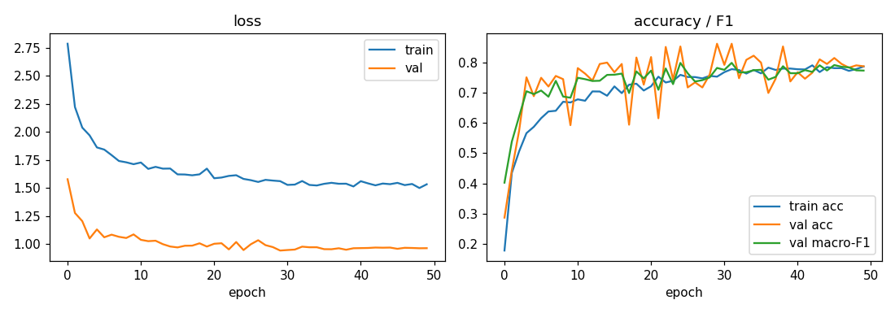

# Eye Disease Image Classification — Final Report

**Date:** 25 November 2026
**Project goal:** classify a single eye image into one of 10 disease/healthy classes.
This is a **learning project only**. It is **not** a medical tool.

---

## 1. What was done, in short

We used only the **5,335 original images** from the Mendeley eye disease dataset.
The 16,242 pre-made augmented images were never downloaded and were not used.

We removed exact duplicates and look-alikes, then made **group-aware** train /
validation / test splits so similar images never cross splits. We then trained:

- 9 CNN models (4 light + 5 heavy) for **50 full epochs** each,
- an SVM and a Random Forest on frozen ResNet18 features.

The final model was chosen by **validation macro F1**, and the test set was used
once at the end for the honest numbers. All models finished; **no model failed**.

---

## 2. Data preparation

### 2.1 Originals only

Step 1 read every image in `Original Dataset`, recorded its class (folder name),
size, file size, and MD5 hash, and wrote `data/splits/all_images.csv`.

- Original images found: **5,335**
- Class names were read from the folder names, never hardcoded.
- Pre-made augmented images: **ignored** (never downloaded).

### 2.2 Exact duplicates (Step 2)

We computed an MD5 hash of each file's bytes. Identical bytes mean an identical file.

- Exact-duplicate hash groups: **470**
- Groups where the same bytes appeared under different classes: **464**
- After removing duplicate copies and all label-conflicting files: **4,387 images** remained.

Label conflicts were printed loudly and removed; we never guessed a correct class.

### 2.3 Look-alikes (Step 3)

Exact hashing misses resized, re-saved, flipped, or lightly edited copies.
We compared deep ResNet18 embeddings (512 numbers per image) with cosine similarity.
We chose **setting A: cosine similarity ≥ 0.98**.

- High-similarity pairs found: **233**
  - same class: **215**
  - different class (possible label noise): **18**
- The 18 cross-class pairs involved **36 images**; all 36 were dropped.
- The 215 same-class pairs were kept as groups, so each group stays together in one split.

Final usable images: **4,351**.
Final groups: **4,164**, with the largest group holding 14 images.

No original image was deleted from disk. We only wrote flags and CSV files.

### 2.4 Train / validation / test (Step 4)

We used stratified group splitting: all images in a look-alike group stay together,
and class proportions stay similar in each split.

| Split | Images | Share |
|---|---:|---:|
| Train | 3,038 | 69.8% |
| Validation | 656 | 15.1% |
| Test | 657 | 15.1% |

- **Train** — the model learns from these images.
- **Validation** — used to choose the best epoch and compare models.
- **Test** — touched once, only for the final report.

Leakage checks all passed:

| Check | Result |
|---|---|
| No file path appears in two splits | PASS — 0 overlaps |
| No MD5 hash appears in two splits | PASS — 0 overlaps |
| No group ID appears in two splits | PASS — 0 overlaps |
| No look-alike pair crosses splits | PASS — 0 pairs |

Full table: [`kaggle_run/summary_table.csv`](kaggle_run/summary_table.csv) (results) and
`outputs/reports/split_leakage_checks.csv` (checks).

### 2.5 Class balance

| Class | Train | Val | Test |
|---|---:|---:|---:|
| CSCR (Central Serous Chorioretinopathy) | 63 | 7 | 10 |
| Diabetic Retinopathy | 1,008 | 219 | 219 |
| Disc Edema | 73 | 14 | 21 |
| Glaucoma | 685 | 148 | 147 |
| Healthy | 563 | 129 | 120 |
| Macular Scar | 238 | 50 | 55 |
| Myopia | 222 | 48 | 48 |
| Pterygium | 11 | 3 | 3 |
| Retinal Detachment | 85 | 18 | 16 |
| Retinitis Pigmentosa | 90 | 20 | 18 |

The classes are strongly imbalanced. Pterygium has only 3 test images, so its
per-class scores are unreliable. This is why we report **macro F1**, not just accuracy.

---

## 3. How the models were run

The notebook `notebooks/eyediseaseclassification1 (2).ipynb` was run on a Kaggle GPU.

### 3.1 Settings

| Setting | Value |
|---|---|
| Seed | 42 |
| Epochs | 50 (full run, no early stopping) |
| Batch size | 32 |
| Image size | 224 × 224 |
| Optimizer | AdamW, weight decay 1e-4 |
| Learning rate | pretrained body 1e-4, new head 1e-3; simple_cnn 1e-3 everywhere |
| Learning-rate schedule | cosine annealing |
| Loss | cross-entropy with class weights and label smoothing 0.1 |
| Augmentation (train only) | random resized crop, horizontal flip, rotation ≤15°, small brightness/contrast jitter |
| Validation / test | resize + ImageNet normalization only |
| Checkpoint | epoch with best **validation macro F1** |
| Mixed precision | yes, on CUDA |
| Failed models | none |

Each image was decoded once, resized to 256 × 256 without cropping, and cached.
The run built 4,010 cached images and reused 341. This made training faster.

### 3.2 Models

**Light group:** `simple_cnn`, `mobilenet_v2`, `resnet18`, `efficientnet_b0`
**Heavy group:** `alexnet`, `densenet121`, `resnet50`, `convnext_tiny`, `swin_t`

All pretrained models started from ImageNet weights; only the final layer is new.
`simple_cnn` was trained from scratch as a baseline.

**Classical baselines:** `SVC(kernel="rbf", class_weight="balanced")` with
C chosen on validation, and `RandomForestClassifier(n_estimators=300,
class_weight="balanced")`, both on frozen ResNet18 features (512 numbers per image).

### 3.3 Metrics

- **Accuracy / top-1:** the correct class is the model's highest-scoring class.
- **Top-3 / top-5:** the correct class is among the 3 or 5 highest scores.
- **Macro F1:** the F1 score of every class averaged equally, so small classes
  count as much as large ones. This is our main selection metric.

---

## 4. Results

### 4.1 Full comparison

Sorted by test macro F1. Source: [`kaggle_run/summary_table.csv`](kaggle_run/summary_table.csv).

| Model | Params (M) | Best epoch | Val macro F1 | Test accuracy | Test top-3 | Test top-5 | Test macro F1 | s/epoch |
|---|---:|---:|---:|---:|---:|---:|---:|---:|
| **swin_t** | 27.5 | 32 | **0.799** | 0.849 | 0.945 | 0.953 | **0.818** | 23.0 |
| resnet50 | 23.5 | 19 | 0.767 | **0.857** | 0.947 | 0.963 | 0.815 | 13.6 |
| densenet121 | 7.0 | 20 | 0.773 | 0.836 | **0.954** | **0.970** | 0.813 | 16.9 |
| resnet18 | 11.2 | 17 | 0.764 | 0.808 | 0.945 | 0.968 | 0.799 | 7.7 |
| mobilenet_v2 | 2.2 | 27 | 0.756 | 0.782 | 0.945 | **0.973** | 0.793 | 8.5 |
| convnext_tiny | 27.8 | 15 | 0.774 | 0.764 | 0.947 | 0.959 | 0.779 | 20.5 |
| efficientnet_b0 | 4.0 | 34 | 0.736 | 0.729 | 0.942 | 0.963 | 0.773 | 10.8 |
| alexnet | 57.0 | 43 | 0.719 | 0.734 | 0.918 | 0.945 | 0.733 | 7.6 |
| SVM (ResNet18 features) | — | — | — | 0.799 | — | — | 0.722 | — |
| Random Forest (ResNet18 features) | — | — | — | 0.693 | — | — | 0.519 | — |
| simple_cnn | 0.4 | 36 | 0.375 | 0.371 | 0.761 | 0.924 | 0.411 | 7.2 |

### 4.2 Final model: Swin Transformer Tiny

We pick the model by **validation macro F1**, not by test score. `swin_t` has the
best validation macro F1 (**0.799**) and also the best test macro F1 (**0.818**).
`resnet50` has slightly higher plain accuracy (0.857 vs 0.849) but lower macro F1,
which means it is weaker on at least some of the smaller classes.

Per-class test report for `swin_t`:

| Class | Precision | Recall | F1 | Test images |
|---|---:|---:|---:|---:|
| CSCR | 0.900 | 0.900 | 0.900 | 10 |
| Diabetic Retinopathy | 0.985 | 0.890 | 0.935 | 219 |
| Disc Edema | 1.000 | 0.952 | 0.976 | 21 |
| Glaucoma | 0.878 | 0.782 | 0.827 | 147 |
| Healthy | 0.925 | 0.825 | 0.872 | 120 |
| Macular Scar | 0.849 | 0.818 | 0.833 | 55 |
| Myopia | 0.857 | 0.875 | 0.866 | 48 |
| Pterygium | 0.051 | 1.000 | 0.097 | 3 |
| Retinal Detachment | 1.000 | 1.000 | 1.000 | 16 |
| Retinitis Pigmentosa | 1.000 | 0.778 | 0.875 | 18 |
| **Macro average** | **0.844** | **0.882** | **0.818** | **657** |
| Weighted average | 0.925 | 0.849 | 0.883 | 657 |

### 4.3 Confusions

The most common mistakes for `swin_t` were:

| True class | Predicted as | Count |
|---|---|---:|
| Glaucoma | Pterygium | 19 |
| Diabetic Retinopathy | Pterygium | 17 |
| Healthy | Pterygium | 10 |
| Healthy | Glaucoma | 8 |
| Macular Scar | Pterygium | 6 |
| Glaucoma | Healthy | 5 |

Pterygium is the main problem: only 3 test images exist, but the model predicts
Pterygium for many images from other classes. Its recall is 1.000 because all 3
true Pterygium images were found, but its precision is only 0.051. With 3 images,
this number is not stable. It should not be read as a real clinical result.

`resnet50` and `densenet121` make the same kind of mistakes, so this is a dataset
problem (tiny class + visually similar diseases), not a single-model bug.

### 4.4 Baselines

- `simple_cnn` reached only 0.411 test macro F1. Pretrained ImageNet features help a lot.
- SVM on frozen ResNet18 features: 0.799 accuracy, 0.722 macro F1.
- Random Forest: 0.693 accuracy, 0.519 macro F1.
- This shows that fine-tuning a pretrained network is worth the extra training time.

---

## 5. How to reproduce

1. Attach the Kaggle `eye_data` dataset and enable GPU + Internet.
2. Open `notebooks/eyediseaseclassification1 (2).ipynb`.
3. First run with `SMOKE = True` to check the pipeline.
4. Set `SMOKE = False`, `SEEDS = [42]`, and use **Save & Run All**.
5. Download `results_bundle_seed42.zip` into `notebooks/`.

The bundle contains probabilities, labels, per-class reports, result JSON files,
curves, confusion matrices, the comparison table, and the exact train split used.
The extracted local copies are in:

- `outputs/reports/kaggle_run/` — one folder per model, with result JSON,
  test report, and probability files
- `outputs/figures/kaggle_run/` — one folder per model, with `curves.png` and
  `confusion_matrix.png`; shared images stay at the top level

---

## 6. Limits

- Images come from **only two hospitals in one district**, so results may not
  generalize to other cameras, populations, or hospitals.
- There is **no patient ID**, so some near-duplicates from the same patient may
  remain even after our look-alike check.
- Pterygium has only 3 test images; per-class scores for it are unreliable.
- We used a single seed (42). More seeds would give a better estimate of stability.
- The test set was used once. Re-tuning after seeing these numbers would make
  the test result optimistic.
- This is a classroom exercise, **not** a medical device or diagnostic tool.

---

## 7. Conclusion

After cleaning 5,335 original images down to 4,351 leakage-safe images, nine CNN
models and two classical baselines were trained for 50 epochs on a grouped
70/15/15 split. All models completed. **Swin Transformer Tiny** is the recommended
final model: validation macro F1 **0.799**, test accuracy **0.849**, test macro F1
**0.818**, test top-3 **0.945**, and test top-5 **0.953**.
`resnet50` is a good smaller/faster alternative if speed matters more than macro F1.
